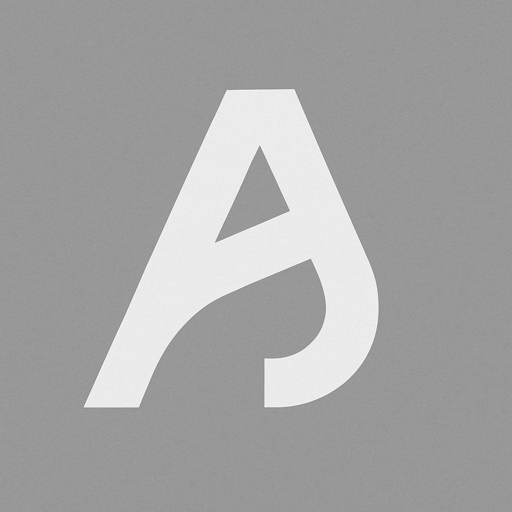

<div align="center">
    
</div>
<h1 align="center">
    personal website
</h1>
<p align="center">
    Built with <a href="https://nextjs.org/">Next.js 16</a> (App Router), <a href="https://tailwindcss.com/">Tailwind CSS v4</a>, <a href="https://mdxjs.com/">MDX</a>, <a href="https://threejs.org/">three.js</a>, and <a href="https://lenis.darkroom.engineering/">Lenis</a>.
</p>
<p align="center">
    A fast, frontend-only portfolio: experience and projects live in JSON, blog posts in MDX, and there's no database to run.
</p>

## getting started

Install dependencies and add your environment variables (see `.env.example`):

```bash
npm install
cp .env.example .env.local
```

Then run the development server:

```bash
npm run dev
```

Open [http://localhost:3000](http://localhost:3000) with your browser to see the result.

Before pushing, check that everything still passes:

```bash
npm run lint && npx tsc --noEmit && npm run build
```

## editing content

Everything on the site is plain files, so updating it is a commit.

| what | where |
| --- | --- |
| experience | `src/config/roles.json` (newest first) |
| projects | `src/config/projects.json` (the first three show on the home page) |
| project images | `public/projects/<slug>/icon.svg` and `screenshot.png` |
| blog posts | `src/content/writing/<slug>.mdx`, registered in `src/content/posts.ts` |
| post images | `public/writing/<slug>/` |
| site name, links, socials | `src/content/site.ts` |

- **experience:** company logos load automatically from [logo.dev](https://www.logo.dev) by company name. If a name matches the wrong brand, pin it with `"logo": { "domain": "acme.com" }`, or set `"logo": false` to keep the monogram tile.
- **projects:** the easiest way to add one is the `/add-project` skill below.
- **blog posts:** each `.mdx` file exports its `metadata` (title, excerpt, date, reading time, tags, cover) at the top. Add one line for it in `src/content/posts.ts` and it shows up on the writing page, the sitemap, and its share image. Set `draft: true` to keep it hidden.

## adding projects with Claude

The repo ships a [Claude Code](https://claude.com/claude-code) skill, `add-project`, that adds a project end to end:

1. gathers the details from the repo (via `gh`) and the live site, drafts the entry, and confirms it and its spot in the list with you
2. captures a 2000×1250 screenshot of the live site, or saves one you give it
3. draws a matching `icon.svg` in the site's style from the screenshot's colours and motif
4. writes the `projects.json` entry
5. checks the cards and page, then runs lint, the type check, and a build

Run it from any Claude Code session in this repo:

```text
/add-project github.com/akramj13/nova-public — put it second, no site yet, use ~/Desktop/nova.png
```

or just ask in plain words, like *"add my new project, here's the repo"*. It never commits on its own.

**Needs:** Google Chrome (for screenshots), the [GitHub CLI](https://cli.github.com/) signed in (to read repos), and macOS (it renders icons with Quick Look to check them).

The skill lives in `.claude/skills/add-project/`, with its test cases in `evals/`. To re-run them after changing the skill:

```bash
cd .claude/skills/add-project && claude plugin eval . --allow-tools Write,Edit,Bash --scaffold
```

## deployment

This site is self-hosted on my own server, with DNS and proxying through [Cloudflare](https://www.cloudflare.com/).

On the server, add `.env.local` with `NEXT_PUBLIC_LOGO_DEV_KEY` **before** building: the key is baked into the build, and without it the experience rows fall back to monogram tiles. Then build and start the production server (it listens on port 3000 by default):

```bash
npm ci
npm run build
npm run start
```

Pages, share images, `sitemap.xml`, and `robots.txt` are generated at build time from the files above. The canonical URL comes from `site.url` in `src/content/site.ts`.
